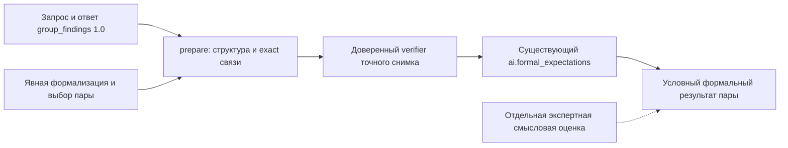

# Автономный адаптер group_findings → Z3

Статус: **локальная реализация для синтетической проверки**. Формат адаптера
не является расширением AI-контрактов 1.0 или DTO backend. Продуктовый вызов,
хранение, worker/API/UI и настоящая модель не подключены.

Адаптер принимает **явно выбранные** находки из канонического снимка
`group_findings`, отдельное подготовленное разложение в атомарные ожидания и
модель контекстов. Текст не извлекается автоматически. Без предложения
возвращается `needs_formalization`, без полного Ω для неизвестного —
`needs_refinements`. Структурная проверка не подтверждает смысл или основание.

## Поток и доверенная граница



`prepare(data)` — отдельный воспроизводимый подготовительный шаг. Он проверяет
канонические вход и выход прежними валидаторами `ai.group_findings`, затем
локальную грамматику, происхождение, ссылки, модель и допустимые уточнения.
При успехе возвращает `Preparation(status="prepared", packet=..., diagnostic=None)`.
**Никакой solver при prepare не вызывается.** `packet` содержит неизменённый
снимок входных данных, полученный вход прежнего Z3 и список невыбранных атомов.

`check_pair(data, verify=callback)` повторяет подготовку и передаёт отдельную
копию packet **явно назначенному доверенному прикладному коду**. Возврат
`None`, `True`, dict, квитанции другого снимка, отказ/исключение или отсутствие
verifier не разрешают вызов Z3. Из входного JSON невозможно назначить callback
или подать себе поле `verification`.

```python
from ai.formal_expectations_bridge import check_pair, prepare, Verification, fingerprint

prepared = prepare(bridge_request_dict)
# Просмотреть подготовку, неизвестные сведения, источники и выбор атомов.

def verify(packet):
    # Настоящая реализация обязана сверить доверенные данные и проверки ниже.
    # Здесь намеренно нет реализации, всегда утверждающей вход.
    approvals = trusted_application_checks(packet)
    return Verification(
        packet_sha256=fingerprint(packet),
        verifier_id=approvals.verifier_id,
        justification=approvals.justification,
        basis_verified=approvals.basis_verified,
        formalization_confirmed=approvals.formalization_confirmed,
        comparability_confirmed=approvals.comparability_confirmed,
        contexts_confirmed=approvals.contexts_confirmed,
        omega_complete_confirmed=approvals.omega_complete_confirmed,
    )

result = check_pair(bridge_request_dict, verify=verify)
```

`trusted_application_checks` в примере обозначает **ещё не реализованный**
прикладной механизм, а не функцию этого репозитория. Он должен проверить:

| Подтверждение | Обязанность доверенного кода |
|---|---|
| basis_verified | Права и проект; точные Finding/Fragment/source/text states; доступность, цитаты/координаты, принадлежность выбранного evidence; источник не удалён |
| formalization_confirmed | Версия и авторство предложения проверены; конкретные известные C/A и интерпретация имеют проверенное основание, неизвестные не вымышлены; разложение и исключения рассмотрены |
| comparability_confirmed | Предметное сопоставление объекта и параметра действительно подтверждено, в том числе синонимы/размерность |
| contexts_confirmed | Атомарное разбиение ситуаций соответствует исходным контекстам, их пересечениям и выбранной модели |
| omega_complete_confirmed | Весь переданный список Ω полон относительно явно ограниченной модели; источник, метод и обоснование проверены |

Первые четыре подтверждения обязательны для любого вывода. Последнее обязательно,
если передано явное Ω, даже одноэлементное и даже с `origin.kind="human"`.
Полная исходная пара без Ω имеет единственный полностью заданный вариант и
не требует утверждения внешнего списка уточнений.

SHA-256 привязывает квитанцию к **всему** packet: исходным запросу/ответу,
текстам/состояниям, выделенным атомам, версии формализации/модели, контекстам,
исключениям и фактическому Ω. Это контроль целостности, не криптографическое
доказательство авторства, прав, полноты или истинности. Callback — доверенная
граница локального Python API. Если прикладной код лжёт, модуль не может
установить это по JSON. Здесь нет подписей, удалённых trust tokens или БД.

Адаптер ничего не публикует/не сохраняет. Будущий вызывающий прикладной слой
обязан повторно проверить актуальную доступность/права перед публикацией;
исторический выбранный state не подменяется новым. Самостоятельный `basis`
в Z3-входе не считается проверенным: он выводится из атома, а доверенная
проверка относится ко всей цепочке исходных ссылок в packet.

## Локальный вход bridge_version 1

Полные готовые входы — в [examples/cases.json](examples/cases.json).
Все объекты закрыты, обязательны ровно объявленные поля. Главная оболочка:

```text
{
  bridge_version: "1",
  grouping_request: <канонический запрос group_findings 1.0>,
  grouping_response: <канонический ответ на этот запрос>,
  selection: {left_finding_keys, right_finding_keys, conflict, rationale},
  proposal: null | <подготовленное разложение>
}
```

`selection.conflict = null` означает явный выбор находок без опоры на наличие
конфликта у LLM. Иначе это `{group_local_id, conflict_local_id, left_position,
right_position}`: индексы позиций с нуля; стороны должны перечислять **все**
находки соответствующих позиций. Даже валидный конфликт LLM не утверждает K.
У каждой выбранной находки coverage должен быть reviewed/completed: неполная
находка или нерассмотренный контекст не считаются полным основанием.
Остальные coverage/questions/uncertainties не теряются: весь снимок сохранён.
Наличие completed тоже само по себе не разрешает solver — нужен verifier.

Предложение:

```text
proposal = {
  version, origin: {kind: human|ai, actor, method}, decomposition_rationale,
  model: {id, version, formal_model, contexts, relations, method, rationale},
  atoms: [{id, object_id, parameter_id, context_id, values, missing_fields,
           sources:[{finding_key, finding_ref, evidence_keys}]}],
  pair: {left_atom_id, right_atom_id, rationale},
  omissions: [{finding_key, reason}],
  omega: null | {origin, method, justification, declared_complete, variants}
}
```

- `origin` описывает происхождение **предложения**, а не доверенность. Версия и
  авторство самого Finding остаются в исходном каноническом снимке. Метка
  `direct/inferred`, цитата, uncertainty_notes и open_questions сохраняются.
- `finding_ref` атома **в точности** равен `FindingView.ref`, включая state_id.
  evidence_keys — непустой явный выбор доступных фрагментов **этой** находки.
  Неуказанный, чужой, удалённый или uncertain фрагмент не становится основанием.
  Для uncertain evidence эта версия блокирует формальное использование;
  история и причина отказа остаются различимы. Это локальное ограничение
  адаптера, а не изменение всех правил группировки.
- Один атом может иметь несколько подтверждающих находок. Одна находка может
  быть разложена на несколько атомов; они не превращаются в независимых людей
  или независимые свидетельства. В модели этой пары все атомы относятся к одному
  параметру; пожелания о других параметрах требуют отдельной подготовки.
- Каждая выбранная находка отражена хотя бы в одном атоме либо в omissions
  с обязательным объяснением. Нельзя молча взять только первую находку позиции.
- pair выбирается явно с объяснением. Атомы выбранной пары должны происходить
  из соответствующих сторон. Остальные атомы перечисляются как
  `unselected_atom_ids`, **не проверенные** этим вызовом. Класс не относится
  автоматически ко всей позиции/группе. При явном выборе разрешены два разных
  атома из одной находки; выбор одного атома дважды запрещён.

### Контексты и значения

`formal_model` имеет прежнюю форму `{object_id,parameter_id,situations,domain}`.
`contexts = [{id,situations:[...]}]` явно отображает каждый исходный контекст
в непустое подмножество атомарных ситуаций. `context_id` атома выбирает это
подмножество целиком; адаптер не разбирает слова и не строит разбиение сам.
Сложная конъюнкция/дизъюнкция должна быть подготовлена как отдельный контекст.

`relations = [{left,right,relation:overlap|disjoint}]` задаёт отношение каждой
неупорядоченной пары исходных контекстов ровно один раз. Пропуск, unknown или
противоречие отображению запрещают подготовленный вывод. Например:

```text
contexts: home -> {home_mobile, home_other}
          mobile -> {home_mobile, other_mobile}
relations: home overlap mobile
```

Общий случай `home_mobile` явно сохранён. Если при том же overlap отобразить
контексты в два непересекающихся множества, будет `context_partition_contradiction`.
Ошибочная декларация disjoint при реально пересекающихся словесных контекстах
не вычисляется из текста; её должен отклонить trusted contexts review.

`values` использует **прежнюю** контролируемую bool/enum/interval грамматику,
единицы и размерности. Структуры проверяются валидаторами существующего
модуля; его математика/транслятор не меняются. Техническое связывание использует
его внутренние `_domain`/`_expectation` и `parse_request`, поэтому обновление
этого компонента требует совместной регрессии и фиксации версии.

`context_id=null` и/или `values=null` требуют точного списка
`missing_fields` из conditions/values. Неизвестное не заменяется универсумом.
Произвольные зависимости A от C не поддержаны: требуется внешнее атомарное
разбиение, как в [исходной модели](../formal_expectations/README.md).

### Ω

`omega.variants` — прежний полный явный список пар C/A, без генерации вариантов.
Сохраняются источник/метод/обоснование и заявленная declared_complete.
Известные поля сравниваются прежним валидатором после нормализации единиц.
Пустой/противоречивый список отклоняется. declared_complete=false или отсутствие
Ω при неизвестном возвращает needs_refinements. declared_complete=true может
пройти **структурную** подготовку, но без подтверждения callback не даёт класса.
Ни строка origin=human, ни одно заявление AI не доказывают полноту.

## Результаты и ошибки

BridgeResult содержит status, packet_sha256, preparation, verification,
formal_result, solver, diagnostic, interpretation, expert_evaluation.
Нет верхнего «истинного класса отзыва»: результат старого модуля находится
только в formal_result и условен относительно принятой формализации.
Expert evaluation всегда `separate_not_computed`; AI/Z3 не подтверждают
автоматически экспертную метку и не принимают HumanDecision.

| status | Значение |
|---|---|
| needs_formalization | Нет подготовленных атомов; возвращён исходный снимок без solver input |
| needs_refinements | Неизвестное не обеспечено полным явно заданным Ω |
| rejected | Структура, ссылки, модель, полнота контекста или допустимость вариантов нарушены |
| verification_required | Структура готова, отсутствует доверенный verifier |
| blocked | Квитанция не подходит либо необходимое подтверждение отсутствует |
| checked | Исходный solver завершил все проверки D/K/S/U |
| formal_failure | Исходный solver вернул техническую диагностику без класса |

Внешний diagnostic относится к адаптеру; у formal_failure технический код
исходного solver расположен в formal_result.diagnostic. Unknown/timeout/resource
никогда не превращаются в U. Параметры выполнения и z3-solver version сохраняются
в solver; формализация/model version — в preparation.input.proposal.

Вход ограничен средствами прежнего bounded JSON decoder и Limits (по умолчанию
1 MiB, глубина 24, ≤50000 узлов). Коллекции адаптера ≤256 элементов, локальные
строки ≤1024, исходные формальные ограничения имеют более строгие прежние
пределы. Подготовка и solver имеют отдельные бюджеты Limits; время внешнего
verifier управляется вызывающим кодом, адаптер не может прервать зависший callback.
Стандартные ограничения native-кода и OS-изоляции прежнего модуля сохраняются.

Данные копируются; callback не может изменить реально проверяемый packet
через полученную копию. Возвращаемый packet предназначен для проверки человеком,
может содержать полный исходный текст и **не должен автоматически попадать в
журналы/архивы**. Прикладной механизм удаления не реализован; proposal по
будущему хранению отдельно описывает обязательные ограничения.

## Воспроизводимый запуск

Python 3.12+, зависимости: z3-solver 4.15.4.0, jsonschema 4.26.0,
referencing 0.37.0; Ruff 0.11.13 только для разработки. Из собственного worktree:

```powershell
python -m venv .venv
.venv/Scripts/python.exe -m pip install -r ai/formal_expectations_bridge/requirements-dev.txt
.venv/Scripts/python.exe -B -m ai.formal_expectations_bridge demo 01-direct-conflict
.venv/Scripts/python.exe -B -m ai.formal_expectations_bridge demo 04-incomplete-information
.venv/Scripts/python.exe -B -W error -m unittest discover -s ai/formal_expectations_bridge/tests -v
.venv/Scripts/python.exe -B -W error -m unittest discover -s ai/formal_expectations/tests -v
.venv/Scripts/python.exe -B -W error -m unittest discover -s ai/tests -v
.venv/Scripts/python.exe -m ruff check ai/formal_expectations_bridge ai/formal_expectations ai/group_findings ai/tests
.venv/Scripts/python.exe -m ruff format --check ai/formal_expectations_bridge ai/formal_expectations ai/group_findings ai/tests
```

Linux: `.venv/bin/python`. `prepare <file.json>` выполняет только структурный
этап и печатает Preparation; общего CLI, принимающего «доверенные» квитанции
из файла для solver, нет. demo принимает только ID встроенного синтетического
каталога и помечает вывод synthetic=true. Его verifier сверяет весь packet с
точным кураторским контрольным снимком; не используется no-op. Негативный demo
`12b-AI-false-completeness` завершается кодом 2 и без formal_result.
Код 0 означает завершение технического этапа; код 2 — неполноту/отказ.

Воспроизведение сохранённых примеров и предварительной разметки:
`python -B -m ai.formal_expectations_bridge.synthetic`.
[cases.json](examples/cases.json) содержит исходные русские тексты, полные
подготовленные структуры, ожидаемый итог в рамках структуры, доверенные
синтетические fault controls и границы вывода. Экспертная разметка вынесена в
[expert-review.json](examples/expert-review.json): PRELIMINARY, verdict=pending,
не semantic gold. Она не определяет ответы verifier или solver.

## Что показали диагностические примеры

| Случаи | Вывод |
|---|---|
| 01/02/03/04 | В принятых структурах воспроизводятся K/D/S/U |
| 05/06 | Синонимы требуют подтверждённого сопоставления; разные параметры отклоняются |
| 07/15 | Разложение одной находки и несколько находок одной позиции сохраняют происхождение |
| 08/10 | Интерпретация AI и ошибочное значение могут дать solver-валидный ложный K; без подтверждения вызов блокируется |
| 09/11 | Противоречивое разбиение ловится структурно; неверное смысловое разбиение, дающее ложный D, требует внешней проверки |
| 12/12b | Отсутствующее или неподтверждённо полное Ω не даёт формального заключения |
| 13 (три пары) | Три S не доказывают совместимость тройки |
| 14/16 | Нет автоматического извлечения текста и произвольной условной SMT-логики |

Полнота реального мира не доказуема этим перечислением. Идентичность смысла,
соответствие C/A тексту и основанию, атомаризация и полнота Ω относительно
явной предметной модели требуют экспертного решения. Qwen может предложить
атомы, алиасы, вопросы/кандидаты контекстов и уточнений; её ответ не заменяет
такое подтверждение и сам по себе не снимает эти ограничения.

## Граница F2 и следующий эксперимент

Read-only изучен опубликованный F2 `4c62684`: GroupDetail.members содержит exact
Finding refs, conflicts.positions — exact ссылки находок; input_findings и
annotations привязаны к выбранным состояниям. prepare/accept и execute_grouping
делают доверенные проверки в коротких транзакциях и отдельный финальный приём.
В этом worktree этих изменений нет. Адаптер работает с каноническим запросом и
ответом AI 1.0, а **не** с backend GroupDetail. local_id конфликта — адрес только
внутри данного ответа, его нельзя объявлять постоянным F2 ID.

Будущий прикладной код может построить разрешённый exact снимок после приёма
group_findings, дать человеку подготовить атомы, вызвать verifier и Z3 вне
транзакции, затем снова проверить состояния перед отдельной публикацией.
Этот план не добавляет роли и не подключает операции продуктовых агентов
друг к другу. Не реализованы worker hooks, DTO/API, миграции или хранение.
Отдельное предложение: [PROPOSED formal result](../../docs/proposals/formal-expectations-results.md).

Следующий гибридный эксперимент: зафиксировать источники и версии, отдельно
записать ответ Qwen и её параметры/seed, получить слепую экспертную разметку
по объекту/параметру/C/A/основанию/неизвестным, затем применять trusted gate
и неизменный Z3. Сравнивать ошибки извлечения, ошибочные K/D, долю воздержаний,
неподтверждённое Ω и технические сбои раздельно. Не объявлять точность Z3
точностью извлечения или универсальной мерой качества.

Фактические тесты, ревью и неисполненные проверки — в [VALIDATION.md](VALIDATION.md).
